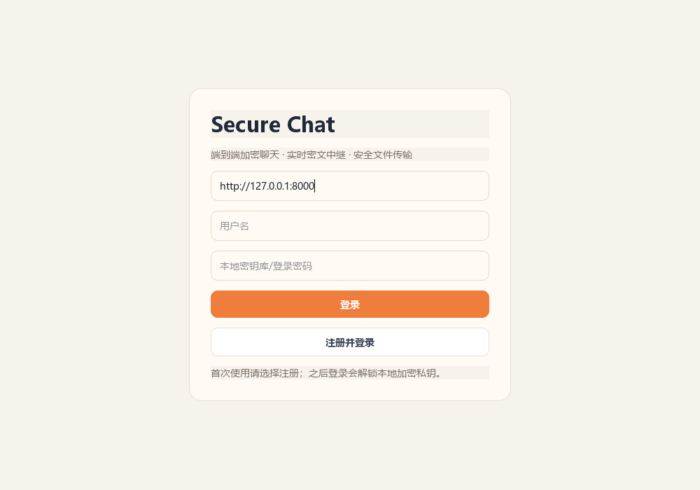
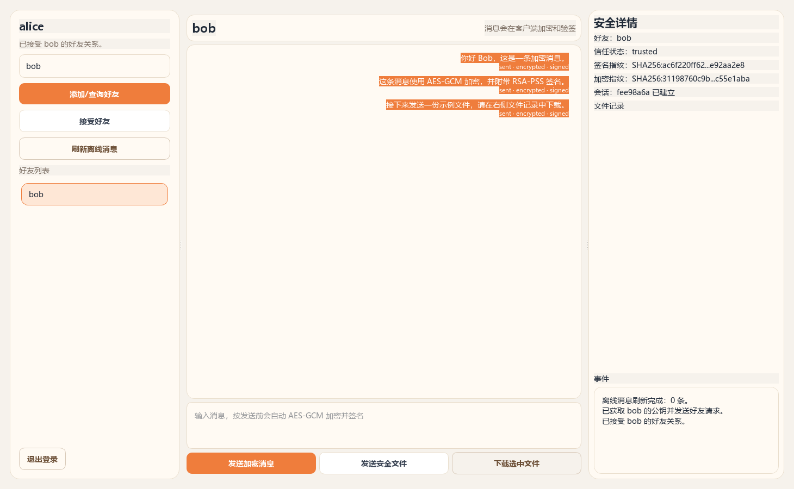
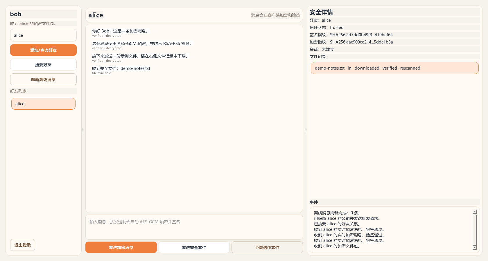

# SecureChat

基于 **Python、FastAPI 与 PySide6** 的即时通信原型，实现客户端消息加密、数字签名、加密文件传输和 WebSocket 实时通知。

客户端负责密钥管理、消息与文件的加解密；服务端负责身份认证、公钥目录、密文中继和离线存储。项目包含独立的密码学模块、桌面客户端、命令行演示及自动化测试，便于阅读、运行和扩展。

## 功能

- **用户与密钥管理**：本地生成独立的 RSA 签名和加密密钥对，使用口令派生密钥加密保存私钥；登录结合口令验证与私钥持有证明。
- **加密文本消息**：AES-256-GCM 加密、RSA-OAEP 会话密钥封装、RSA-PSS 签名，以及会话内的消息序号检查。
- **实时与离线消息**：WebSocket 推送在线事件，SQLite 保存待拉取的密文消息。
- **加密文件传输**：发送前进行基础规则扫描，使用独立文件密钥加密；接收后验签、校验哈希、解密并复检。
- **桌面客户端**：注册登录、好友查询与添加、聊天记录、文件收发，以及公钥指纹和会话状态展示。
- **独立演示与测试**：无需启动服务端即可演示核心协议；测试覆盖消息、文件、认证、本地存储和实时事件解析。

## 运行截图

以下截图来自实际运行的 PySide6 客户端，使用临时测试账号 `alice`、`bob` 与本地 FastAPI / WebSocket 服务。展示过程中完成了注册登录、三条加密消息的接收验签，以及示例文件的下载、哈希校验和复检。

### 登录与注册



### 加密消息

发送端展示好友、公钥指纹、会话状态和已加密签名的消息；接收端已验证并解密对应消息。



### 文件传输

接收端完成示例文件下载，文件记录显示 `downloaded · verified · rescanned`，下载内容与发送文件一致。



## 系统架构


文本和文件在客户端完成加密后才提交到服务端，接收客户端验证签名与完整性后解密。服务端仍可观察用户名、通信双方、时间和文件大小等元数据。GUI 的本地聊天数据库会保存解密后的消息，详细边界见 [安全说明](docs/SECURITY.md)。

## 快速开始

### 1. 获取代码

```bash
git clone https://github.com/YiYun-ll/SecureChat.git
cd SecureChat
python -m venv .venv
```

本次验证环境为 Python 3.12。激活虚拟环境后，在仓库根目录执行后续命令。

Windows PowerShell：

```powershell
.\.venv\Scripts\Activate.ps1
```

macOS / Linux：

```bash
source .venv/bin/activate
```

安装依赖：

```bash
python -m pip install -r requirements.txt
```

依赖包含 PySide6 桌面组件；无图形桌面的环境可以运行服务端、命令行演示和自动化测试。

### 2. 运行命令行演示

```bash
python -m client.demo
```

演示在临时目录中创建 Alice 和 Bob 的密钥库，完成消息加解密、篡改拒绝、文件恢复和 EICAR 测试串阻断，运行结束后自动清理临时数据。EICAR 是检测测试串，部分终端防护软件会隔离生成的测试文件，导致对应演示或测试中断；这类环境限制需与程序自身的检测结果分别记录。

### 3. 启动服务端

```bash
python -m uvicorn server.main:app --host 127.0.0.1 --port 8000
```

保持该终端运行。开发时可添加 `--reload`；API 交互文档位于 [http://127.0.0.1:8000/docs](http://127.0.0.1:8000/docs)。

### 4. 启动桌面客户端

在另外两个已激活虚拟环境的终端中，分别执行：

```bash
python -m client.main
```

两个客户端的服务端地址均使用 `http://127.0.0.1:8000`。分别注册 `alice` 和 `bob`，查询并添加对方为好友，选择好友后发送消息或文件。完整操作见 [使用指南](docs/USAGE.md)。

## 消息与文件流程

发送方使用接收方公钥封装会话密钥，对会话信封和消息包签名。接收方先验证来源与完整性，再恢复会话密钥并解密消息。


文件传输会额外生成独立文件密钥，并在签名清单中记录文件大小、哈希和扫描结果。


## 运行测试

```bash
python -m pytest -q
```

测试覆盖密码学封装、密钥库解锁、消息与元数据篡改拒绝、会话内重放检查、文件扫描和加密传输、注册登录、公钥目录、好友关系、WebSocket 事件及客户端本地存储。测试使用临时文件和数据库，不需要运行中的服务端，也不需要打开 GUI。

## 项目结构

```text
SecureChat/
├── client/
│   ├── main.py              # PySide6 桌面入口
│   ├── demo.py              # 独立命令行演示
│   ├── api_client.py        # REST API 客户端
│   ├── realtime.py          # WebSocket 监听
│   └── local_store.py       # 本地 SQLite 状态
├── common/secure_chat/
│   ├── crypto_utils.py      # 密码学与口令派生封装
│   ├── key_store.py         # 本地加密密钥库
│   ├── messages.py          # 会话与消息协议
│   ├── file_scanner.py      # 文件基础规则扫描
│   └── file_transfer.py     # 文件加密与校验
├── server/
│   ├── main.py              # FastAPI 应用与实时中继
│   └── database.py          # 服务端 SQLite schema
├── tests/                   # 自动化测试
├── docs/                    # 使用指南、架构与安全说明
└── requirements.txt
```

## 本地数据

- `server_data/secure_chat.sqlite`：账号、公钥、好友关系、离线密文消息、文件包和审计元数据。
- `client_data/<username>/key_store.json`：口令加密的私钥与公钥信息。
- `client_data/<username>/chat.sqlite`：好友、会话信封、解密后的本地聊天记录及文件状态。
- `client_data/<username>/downloads/`：接收并验证的文件。

以上运行时目录已被 Git 忽略。登录需要账号对应的本地私钥；删除密钥库后，单凭密码无法恢复原账号的私钥证明能力。

## 当前边界

本项目适合本机实验与协议实现研究，当前实现仍有以下限制：

- 客户端未校验公钥目录响应的服务端签名，好友的 `trusted` 状态也不代表已完成人工指纹核验。
- 会话信封包含过期时间，但接收端尚未强制校验；重放跟踪状态保存在内存中，重启后会丢失。
- 服务端令牌与服务端 RSA 密钥在内存中维护，重启后需重新登录；尚未提供完善的令牌过期和撤销机制。
- 本地消息数据库未加密；文件扫描使用大小、扩展名、测试串和文本规则，不能作为完整的恶意文件检测结论。
- 尚未提供完整的消息确认去重、多设备同步、群聊与前向保密机制。

更多实现细节和后续方向见 [架构说明](docs/ARCHITECTURE.md) 与 [安全说明](docs/SECURITY.md)。
