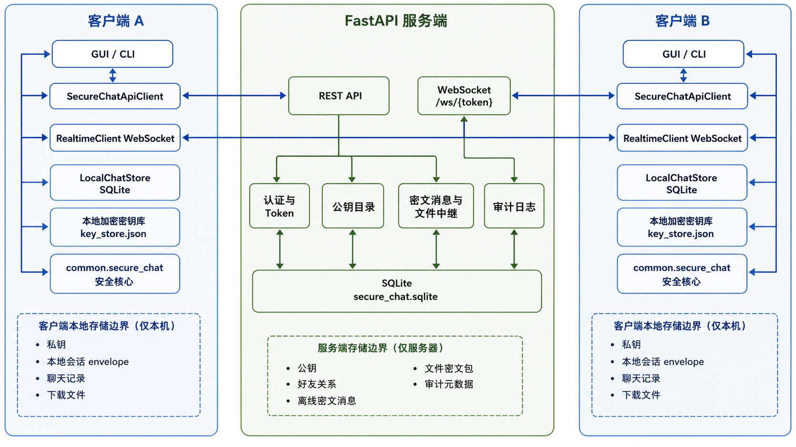
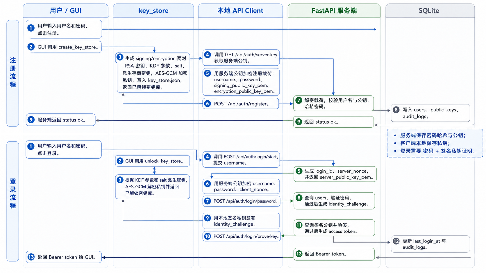
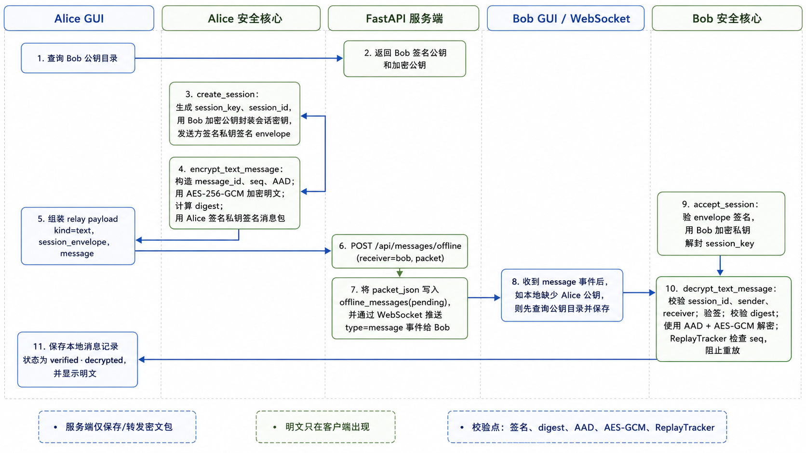
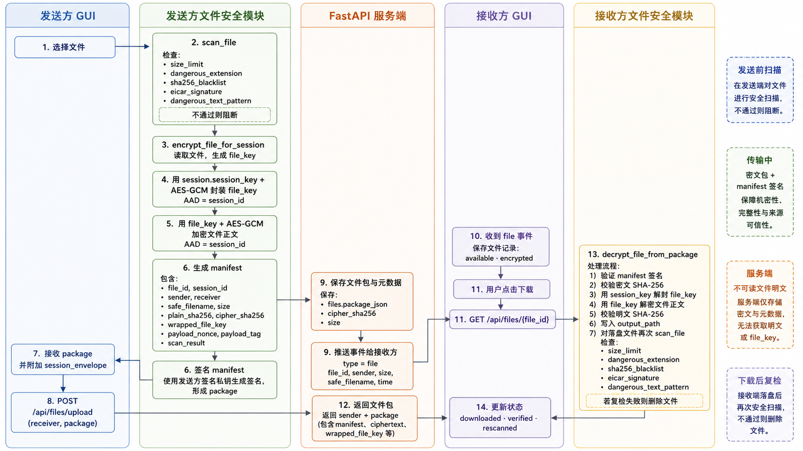

# 系统架构

SecureChat 采用客户端安全核心与服务端密文中继分离的结构。REST API 负责请求与持久化，WebSocket 负责实时事件，SQLite 分别保存服务端和客户端状态。

## 模块职责

- `common.secure_chat.crypto_utils`：RSA-3072 密钥、RSA-OAEP-SHA256、RSA-PSS、AES-GCM、SHA-256 和口令派生。
- `common.secure_chat.key_store`：生成签名与加密密钥对，创建和解锁本地加密密钥库。
- `common.secure_chat.messages`：会话密钥封装、信封与消息包签名、消息解密和内存序号跟踪。
- `common.secure_chat.file_scanner`：文件大小、扩展名、EICAR 测试串、哈希黑名单参数和危险文本规则。
- `common.secure_chat.file_transfer`：独立文件密钥、签名清单、文件加密与接收校验。
- `client.api_client`：REST API 调用及注册、登录载荷加密。
- `client.realtime`：后台 WebSocket 监听与事件解析。
- `client.local_store`：好友公钥、会话信封、消息与文件状态的本地持久化。
- `client.main`：桌面交互、网络调用、协议处理与本地状态的组织入口。
- `server.main` / `server.database`：认证、公钥目录、好友关系、密文消息与文件包存储、实时事件和审计日志。

## 注册与登录

客户端为每个用户生成两对 RSA 密钥，将私钥用口令派生密钥加密后保存。注册请求向服务端提交公钥和加密的账号载荷。服务端保存口令派生哈希和用户公钥。

登录依次完成口令验证与签名私钥挑战，成功后获得访问令牌。加密载荷的服务端公钥也由服务端提供；其信任建立限制见 [安全说明](SECURITY.md)。

## 文本消息

1. 发送方查询接收方公钥，生成随机会话密钥并使用 RSA-OAEP 封装。
2. 发送方对会话信封签名，使用 AES-256-GCM 加密消息，并对消息包进行 RSA-PSS 签名。
3. 服务端保存密文载荷，并向在线接收方发送 WebSocket 事件。
4. 接收方验证信封、恢复会话密钥，验证消息签名、元数据、完整性和序号后解密。
5. GUI 将验证后的明文保存到本地 SQLite，并显示聊天记录。

## 文件传输

发送方先进行基础规则扫描，再生成独立文件密钥。文件密钥用会话密钥加密，文件内容用文件密钥加密；签名清单记录接收方、会话、文件大小、哈希和加密参数。

服务端保存文件包并发送通知。接收方下载后验证清单签名与密文哈希，解密后校验明文哈希，再进行扫描。

## 状态与存储

服务端 SQLite 包含账号、公钥、好友、离线消息、文件和审计记录。服务端密钥、令牌和登录挑战为进程内状态。

客户端密钥库存储口令加密的私钥；聊天数据库存储好友公钥、会话信封、消息包、已解密明文和文件记录。内存中的会话密钥和重放序号不等同于数据库中的会话信封。

## 后续方向

优先完善公钥目录验签与人工指纹核验、会话过期检查、重放状态持久化、消息确认去重、令牌生命周期及服务端密钥持久化。具体边界见 [安全说明](SECURITY.md)。
